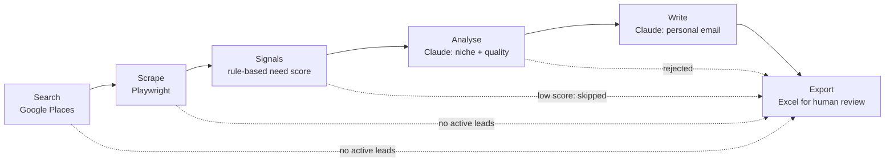

# Lead Scraper — AI B2B Prospecting Pipeline

**Finds local businesses, analyses their website, scores how much they would benefit from automation, and drafts a personalised outreach email for a human to review.**


[](https://github.com/DomienDarmontAntwerpen/lead-scraper/actions/workflows/tests.yml)

> **In short:** you enter a type of business ("plumber") and a region ("Antwerp"). The pipeline finds matching companies through Google Places, reads their website, detects manual processes (no online booking, contact only by phone, and so on), skips companies with no clear need, and writes a short, personal email for each remaining lead. The output is an Excel file for a human to review. **Nothing is ever sent automatically.**



---

## What it does

- **Search**: finds businesses by keyword and region with the Google Places API.
- **Scrape**: reads each website with a headless browser (Playwright) and respects `robots.txt`.
- **Signals**: rule-based detection of manual processes (forms, `mailto:` and `tel:` links, missing booking widgets) and a "need score". Low-scoring leads are skipped before any paid LLM call.
- **Analyse**: Claude determines the company's niche and rejects unusable data.
- **Write**: Claude drafts a personalised email with an opening line based on what was found on the site.
- **Verify & comply**: optional email verification (NeverBounce), a suppression list, a mandatory opt-out line, and spam-trigger checks in code.
- **Export**: an Excel file with the approved leads, plus an audit log of every lead and why it was kept or rejected.

## How it works

The pipeline is a LangGraph `StateGraph`. Each node updates a shared, typed state. Conditional edges jump straight to `export` as soon as no active leads remain, so one broken website never stops a run. The cheap rule-based scoring runs before the expensive LLM steps to keep costs low.

## Tech stack

| Layer | Technology |
|---|---|
| Orchestration | LangGraph `StateGraph` |
| LLM | Anthropic Claude (via LangChain) |
| Data sources | Google Places API, Playwright, BeautifulSoup |
| Validation | Pydantic |
| Output | openpyxl (Excel) |
| UI | Streamlit |
| Testing | pytest, respx (all external APIs mocked) |

## Getting started

### Prerequisites
- Python 3.11+
- API keys for Anthropic and Google Places (NeverBounce is optional)

### Installation
```bash
git clone https://github.com/DomienDarmontAntwerpen/lead-scraper.git
cd lead-scraper
python3 -m venv .venv
source .venv/bin/activate
pip install -r requirements.txt
playwright install chromium
```

### Configuration
```bash
cp .env.example .env
```
Fill in `ANTHROPIC_API_KEY` and `GOOGLE_PLACES_API_KEY`. Optionally, copy `data/suppression.example.csv` to `data/suppression.csv` and list the domains that must never be contacted.

### Run
From the command line:
```bash
python main.py --query "loodgieter" --region Antwerpen --max-leads 20
```
Or with the web interface:
```bash
streamlit run app.py
```
The result is written to `data/output/leads_<region>_<timestamp>.xlsx`, with a **Leads** sheet for review and an **audit_log** sheet that lists every lead with its source and the reason it was kept or rejected.

The code and interface are in English. The search terms, detection keywords and generated emails are in Dutch, because the target businesses are Flemish.

## Running the tests
```bash
pytest
```
81 tests. Google Places, Playwright and Claude are all mocked, so no API credits are used.

## Project structure
```
lead-scraper/
├── src/
│   ├── graph.py        # LangGraph wiring and conditional edges
│   ├── state.py        # Typed pipeline state
│   ├── config.py       # Settings and API keys
│   ├── compliance.py   # Opt-out, suppression list, spam-trigger checks
│   └── nodes/          # search · scrape · signals · analyze · write · export
├── data/
│   └── suppression.example.csv  # Format of the do-not-contact list
├── tests/
├── main.py             # Command-line entry point
├── app.py              # Streamlit interface
└── requirements.txt
```

## Responsible use
This tool prepares B2B outreach. It does not send it. Every email must be reviewed and sent manually. Each draft contains an opt-out sentence (validated in code), and the suppression list is applied before anything else. The sender is responsible for GDPR compliance.

## Status & next steps
Working and used for real prospecting runs. Possible next steps: CRM export and follow-up tracking.

## Author
**Domien Darmont**, AI Engineer, Antwerp, Belgium  
GitHub: [@DomienDarmontAntwerpen](https://github.com/DomienDarmontAntwerpen)  
LinkedIn: [Domien Darmont](https://www.linkedin.com/in/domien-darmont-b53b7640b/)

A live demo or more information is available on request.

## License
© 2026 Domien Darmont. All rights reserved.

The source code of this project is published for viewing and evaluation only. No permission is granted to copy, modify, distribute or use it, in whole or in part, without prior written consent from the author.
